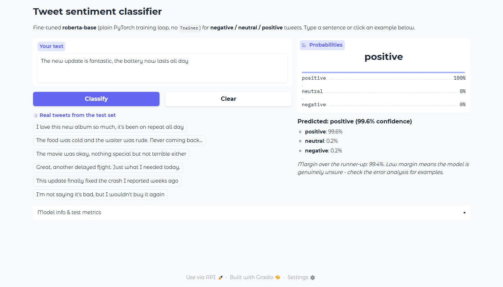
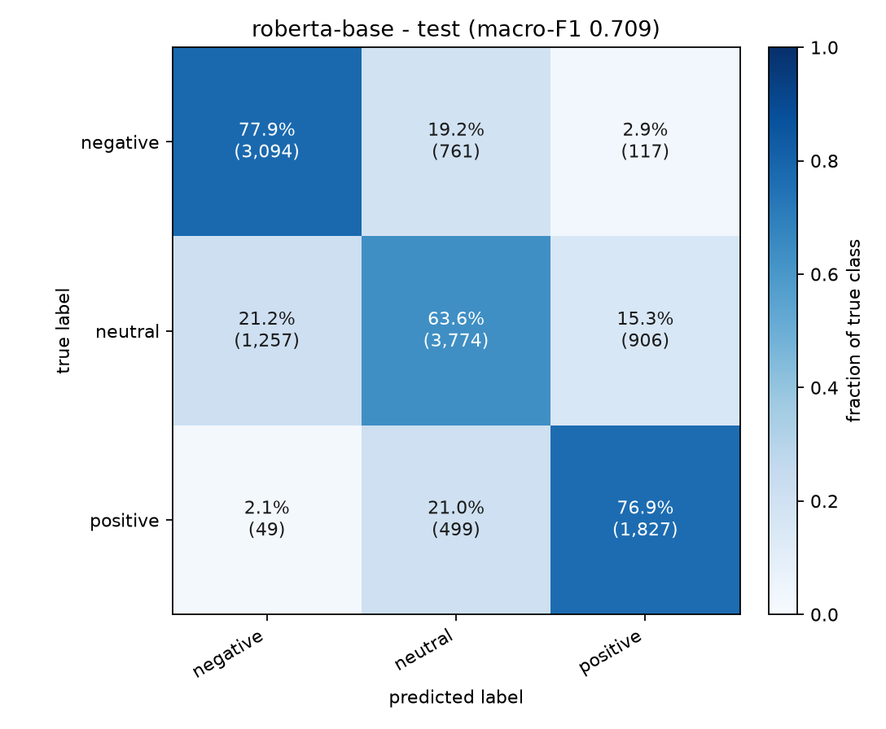

# Tweet sentiment classification with a hand-written PyTorch loop

Fine-tuning a transformer for 3-class sentiment (**negative / neutral / positive**) on
[TweetEval](https://huggingface.co/datasets/tweet_eval), compared against a strong
TF-IDF baseline, tracked in MLflow, analysed for failure modes, and shipped as a
Gradio demo.

**Everything here was run on the machine described below — no numbers are estimated.**
The source of truth is [`results/experiments.csv`](results/experiments.csv), each run's
JSON in `results/runs/`, and the MLflow store in `mlruns/`.



---

## Headline results

Held-out official TweetEval test split (12,284 tweets, never used for model selection):

| model | test accuracy | test macro-F1 | training time |
|---|---:|---:|---:|
| Always predict `neutral` (reference) | 0.4831 | 0.2172 | 0 s |
| TF-IDF + Logistic Regression (baseline) | 0.6131 | 0.5970 | 86 s (CPU; features + C grid) |
| **RoBERTa-base, 3 epochs (selected on validation)** | **0.7078** | **0.7088** | 447 s (GPU) |

The fine-tuned model beats the baseline by **+9.5 accuracy points** and
**+11.2 macro-F1 points** on identical splits. Macro-F1 is the headline metric
because the classes are imbalanced (neutral ≈ 45–48% of every split).

Why the jump is mostly on *negative*: the baseline catches only 46.2% of negative
test tweets, the transformer catches 77.9% (see per-class table below). The test
split contains twice as many negatives as the training distribution, so this
matters a lot.

### Validation results (this is what model selection used)

| run | model | lr | epochs | val accuracy | val macro-F1 | time | peak GPU |
|---|---|---:|---:|---:|---:|---:|---:|
| `e1_lr3e-5` | DistilBERT | 3e-5 | 3 | 0.7291 | 0.7138 | 268 s | 1,509 MB |
| `e2_lr2e-5_4ep` | DistilBERT | 2e-5 | 4 | 0.7298 | 0.7140 | 263 s | 1,509 MB |
| `e3_lr5e-5` | DistilBERT | 5e-5 | 3 | 0.7338 | 0.7131 | 206 s | 1,509 MB |
| **`e4_roberta_lr2e-5`** | **RoBERTa-base** | **2e-5** | **3** | **0.7468** | **0.7348** | 447 s | 2,851 MB |
| `e5_frozen_encoder` | DistilBERT, encoder frozen | 1e-3 | 3 | 0.6665 | 0.6364 | 74 s | 386 MB |

Only the validation-selected model (`e4`) was evaluated on test. The other runs
exist to compare hyper-parameters and architectures; giving them test numbers
would invite test-set tuning. (The baseline is the exception: it is a single fixed
model, so it is evaluated once to provide the same-split comparison.)

The three DistilBERT learning rates land within 0.001 macro-F1 of each other —
*lr is not the lever here*. Changing the architecture to RoBERTa-base gained
+0.021, and freezing the encoder cost −0.077, so **fine-tuning the encoder is where
almost all the signal is**. Full per-epoch curves:
`results/figures/<run>_curves.png`.

### Per-class test results (12,284 examples)

| class | support | baseline P / R / F1 | RoBERTa P / R / F1 |
|---|---:|---|---|
| negative | 3,972 | 0.670 / 0.462 / 0.547 | **0.703 / 0.779 / 0.739** |
| neutral | 5,937 | 0.615 / **0.709** / 0.659 | **0.750** / 0.636 / **0.688** |
| positive | 2,375 | 0.550 / 0.624 / 0.585 | **0.641 / 0.769 / 0.699** |
| macro avg | 12,284 | 0.612 / 0.599 / 0.597 | **0.698 / 0.728 / 0.709** |



Baseline confusion matrix for comparison:
`results/figures/baseline_confusion_matrix.png`.

**The weakness is neutral.** RoBERTa has the best precision on neutral (0.750) but
recall only 0.636 — it turns many neutral tweets into positive or negative. 95.4%
of all test errors involve the neutral class. That is the subject of the error
analysis.

---

## Why this dataset

| candidate | pros | cons | verdict |
|---|---|---|---|
| IMDb | classic, clean | binary, long reviews, ~90% baseline → little headroom | rejected |
| SST-2 (GLUE) | standard | binary, tiny, almost saturated | rejected |
| `emotion` (6 classes) | more classes | more of an emotion-recognition task than sentiment | considered |
| **TweetEval sentiment** | 3-way polarity, real noisy social text, 45k/2k/12k official splits, known benchmark | noisy labels, label shift between splits | **chosen** |

TweetEval gives what a portfolio project needs: a *learnable* task with a strong
baseline (~0.60 macro-F1), genuine headroom, and naturally interesting failures
(sarcasm, negation, neutral news). It is also small enough to fine-tune multiple
configurations on an 8 GB laptop GPU in minutes. The dataset's official train
(45,615) and validation (2,000) splits are merged and re-split 90/10 (42,827 /
4,759) with seed 42; the official test split is untouched until the final
evaluation.

**A real property of this benchmark:** the official test set is *not* drawn from
the same label distribution as train/val (train: 15.6% negative / 45.2% neutral /
39.2% positive; test: 32.3% / 48.3% / 19.3%). That is documented in
`results/eda_summary.md`; it explains most of the validation→test gap and is
listed under limitations. The test set was **not** re-balanced.

## Why these models

* **Baseline** — TF-IDF word 1–2 grams + character 3–5 grams, 195,494 features,
  multinomial logistic regression. Class `C` selected on validation macro-F1
  (C=2.0). A linear bag-of-ngrams model is the right honesty check before adding
  a transformer.
* **DistilBERT** (`distilbert-base-uncased`, 67M params) — fast, 6 layers, fits
  easily in 8 GB at batch size 32.
* **RoBERTa-base** (125M) — trained on much more text and generally stronger on
  social-media-style English; it won the validation comparison.
* **Frozen encoder** — an ablation that trains only the 593k-parameter head, to
  show that the gain comes from fine-tuning, not from the head alone.

The task is deliberately **not** using `transformers.Trainer`. `src/train.py` is a
plain PyTorch loop with explicit optimizer parameter groups, warmup/decay
scheduler, AMP + `GradScaler`, gradient clipping, per-epoch validation,
best-checkpoint saving and early stopping. `docs/EXPLAINER.md` walks through it
line by line.

---

## Training loop (what is actually in `src/train.py`)

* `DataLoader` with a seeded shuffle; dynamic per-batch padding (`PadCollator`),
  `num_workers=0` (Windows-safe).
* `AdamW`, weight decay 0.01 on weight matrices only (no decay on biases/LayerNorm),
  betas (0.9, 0.999).
* Linear warmup for 10% of steps, then linear decay to 0 (`LambdaLR`).
* Mixed precision: fp16 `autocast` + `GradScaler`, gradient clipping at norm 1.0.
  The scaler's overflow skips are counted (`grad_norm_nonfinite_steps`, 1–4 per
  run) instead of poisoning the epoch mean.
* Per-epoch validation (loss, accuracy, macro-F1), best checkpoint on **val
  macro-F1**, early stopping with patience 2.
* Fixed seeds (`42`) for Python/NumPy/PyTorch/CUDA, `cudnn.deterministic=True`,
  seeded DataLoader generator.
* MLflow: all hyper-parameters, per-epoch train/val metrics, learning rate, epoch
  time, GPU peak allocation, run config and curves as artifacts.

---

## Error analysis

Full report: **[`results/error_analysis.md`](results/error_analysis.md)** (24 real
misclassified tweets with hypotheses). Summary:

| failure pattern | example (true → predicted, confidence) | why |
|---|---|---|
| Sarcasm / figurative language | "I'm Dying😂😂😂 #TheWalkingDead" (positive → negative, 0.98) | "dying"/"killing" read literally |
| Negation & contrast | "We love our green vehicles … but sometimes lack of infrastructure…" (neutral → positive, 0.99) | the "but" clause is ignored |
| Neutral vs opinion boundary | "Bookends to a Disastrous Presidency…" (neutral → negative, 0.99) | news/commentary phrasing vs annotation guideline |
| Short text / world knowledge | "'Kim Fatty the Third'" (negative → neutral, 0.99) | meaning lives outside the text |
| Probable label noise | "i am so blessed" (neutral → positive, 1.00) | looks mislabelled |

Other findings:

* **95.4% of the 3,589 test errors involve neutral**; neutral recall (0.636) is the bottleneck.
* **The model is confidently wrong**: mean confidence on errors is 0.759 and 25.0%
  of errors are ≥ 0.90. Softmax scores are not a reliable uncertainty signal here.
* **Emoji and slang are only partly handled**, and political/news tweets dominate
  the high-confidence errors.
* Two proposed fixes are in the report: (1) label smoothing + class-weighted loss
  toward neutral, with temperature scaling for calibration; (2) a label-noise
  audit and a stronger model (`deberta-v3-base` / `BERTweet`), validated on
  validation only.

Confidence of correct vs wrong predictions:
`results/figures/e4_roberta_lr2e-5_test_confidence.png`.

---

## Web demo


A Gradio Blocks app that loads the best checkpoint (GPU if available), shows the
label plus all three probabilities and the margin, has six real test tweets as
one-click examples, and a model-card accordion with the real test metrics and
per-class table.

```powershell
python app.py          # http://127.0.0.1:7860
```

The demo currently runs at **http://127.0.0.1:7860** (verified with HTTP 200 and a
real `/classify` API call, not just a page load). The sarcastic example
"Great, another delayed flight. Just what I needed today." is classified
**positive** — that is a genuine demo of the limitation analysed above, not a
cherry-picked success.

---

## Installation

Tested on Windows 11 with Python 3.12.10. Python 3.13+ may not have PyTorch wheels yet.

```powershell
# 1. environment
python -m venv .venv
.\.venv\Scripts\Activate.ps1

# 2. CUDA PyTorch first (cu128 wheels work on CUDA 12.8+ drivers, incl. 13.x)
pip install torch==2.11.0 --index-url https://download.pytorch.org/whl/cu128

# 3. everything else
pip install -r requirements.txt

# 4. verify the GPU and mixed-precision path
python -m src.check_env
```

Expected output ends with
`OK: GPU is usable for mixed-precision training.` (It also prints the GPU name,
VRAM, bf16 support and an fp16-vs-fp32 matmul speedup.)

> **Dataset loading note.** `datasets 5.1` + `huggingface_hub 2.2` reject
> *namespace-less* Hugging Face dataset ids (`tweet_eval`, `imdb`, …) with
> `Repository id must be 'namespace/name'`. `src/data.py` tries
> `load_dataset("tweet_eval", "sentiment")` first and falls back to the identical
> official parquet files from the Hub. Same data, same splits.

## Reproducing the project

```powershell
# Phase 1 - data + EDA (writes results/eda_summary.md and figures)
python -m src.data

# Phase 2 - baseline (MLflow run + results/runs/baseline_tfidf_logreg.json)
python -m src.baseline

# Phase 3 - smoke test of the loop (512 tweets, 1 epoch, ~3 s)
python -m src.train --smoke --experiment e1_lr3e-5

# Phase 4 - the experiments (about 20 minutes total on the RTX 3070 Ti)
python -m src.train --experiment e1_lr3e-5
python -m src.train --experiment e2_lr2e-5_4ep
python -m src.train --experiment e3_lr5e-5
python -m src.train --experiment e4_roberta_lr2e-5
python -m src.train --experiment e5_frozen_encoder

# Phase 5 - evaluate the best checkpoint ONCE on test + confusion matrix + error CSV
python -m src.evaluate --checkpoint checkpoints/e4_roberta_lr2e-5/best.pt

# comparison table
python -m src.summarize

# error-analysis candidate list (the report is written by hand from real examples)
python -m src.error_analysis --csv results/errors_e4_roberta_lr2e-5_test.csv

# Phase 6 - demo
python app.py
```

Any hyper-parameter can be overridden on the command line
(`--lr`, `--epochs`, `--batch-size`, `--max-length`, `--amp-dtype bf16`,
`--no-mlflow`, `--run-name`, ...). `--amp-dtype bf16` also works on this GPU.

### Viewing the MLflow runs

```powershell
$env:MLFLOW_ALLOW_FILE_STORE="true"   # MLflow 3.x opts in to the local file store
.\.venv\Scripts\mlflow.exe ui --backend-store-uri ./mlruns --port 5001
```

Each run logs params, per-epoch metrics (train/val loss, accuracy, macro-F1,
learning rate, epoch time, GPU peak memory), final metrics and artifacts
(training curves, run config, full run record).

---

## Project structure

```
NLPProject/
├── app.py                       # Gradio demo (loads best checkpoint)
├── requirements.txt
├── .gitignore
├── src/
│   ├── config.py                # paths, dataset constants, presets, seeding, GPU info
│   ├── data.py                  # HF dataset -> stratified splits -> EDA -> DataLoaders
│   ├── check_env.py             # GPU / AMP sanity check
│   ├── baseline.py              # TF-IDF + Logistic Regression + MLflow
│   ├── model.py                 # tokenizer/model loading helpers
│   ├── train.py                 # THE custom PyTorch training loop + MLflow
│   ├── evaluate.py              # test metrics, confusion matrix, error CSV
│   ├── error_analysis.py        # buckets errors for the manual report
│   ├── predict.py               # inference helper shared by app + CLI
│   ├── plotting.py              # confusion matrix / classification report helpers
│   └── summarize.py             # results/runs/*.json -> results/experiments.csv
├── results/
│   ├── experiments.csv          # every run, one row
│   ├── eda_summary.md           # class balance, lengths, tokenizer coverage
│   ├── error_analysis.md        # 24 verified misclassified examples + fixes
│   ├── baseline_*.md/.csv       # baseline report + C grid
│   ├── errors_*.csv             # all 3,589 test errors with probabilities
│   ├── figures/                 # EDA, curves, confusion matrices, confidence
│   └── runs/                    # one JSON per run (source of results table)
├── checkpoints/                 # best.pt per run (gitignored)
├── data/                        # cached splits + raw parquet (gitignored)
├── mlruns/                      # local MLflow store (gitignored)
├── docs/
│   ├── EXPLAINER.md             # line-by-line walkthrough + interview Q&A
│   └── demo_screenshot.png
└── notebooks/                   # placeholder (EDA is scripted in src/data.py)
```

## Hardware and timings

| | |
|---|---|
| GPU | NVIDIA GeForce RTX 3070 Ti Laptop, 8 GB, driver 617.42 (CUDA 13.4), sm_86 |
| CPU / RAM | Intel i9-12900H (14C/20T) / 15.7 GB |
| OS | Windows 11 Pro for Workstations (build 22621) |
| Python / PyTorch | 3.12.10 / 2.11.0+cu128 |
| Precision | fp16 autocast + GradScaler (bf16 also supported by this GPU) |
| fp16 vs fp32 matmul | 4.23 ms vs 21.17 ms for 4096² → **5.0×** |

| stage | wall time | peak GPU memory |
|---|---:|---:|
| EDA (incl. dataset download) | ~30 s | — |
| baseline (TF-IDF + 5-point C grid) | 86 s | — |
| DistilBERT run (3 epochs, 42.8k tweets) | 206–268 s | 1,509 MB |
| RoBERTa-base run (3 epochs) | 447 s | 2,851 MB |
| frozen encoder ablation | 74 s | 386 MB |
| test evaluation (12,284 tweets) | 9.3 s | — |

All five fine-tuning runs + baseline finish in **~22 minutes** on this laptop.

## Reproducibility notes

* Seeds fixed everywhere (`42`); `cudnn.deterministic=True`, benchmark off.
* Splits cached as parquet, so reruns use the exact same data.
* DataLoader workers are 0 on Windows to avoid spawn issues; this has no effect
  on results.
* Two e1/e2 reruns (to fix a gradient-norm logging bug) took longer than the
  first pass (268 s / 263 s vs 194 s) because the machine was simultaneously
  running analysis scripts. Metrics were identical, which is the expected
  outcome of the deterministic setup.
* The final test-evaluation command was re-run once to regenerate the plots
  after a filename fix. It is deterministic: the metrics were identical
  (accuracy 0.7078, macro-F1 0.7088) and no model selection touched test.
* Versions are pinned in `requirements.txt`.

## Limitations

1. **Label shift**: the official test distribution differs strongly from train
   (32% vs 16% negative). Validation macro-F1 (0.735) therefore overstates test
   performance (0.709). Do not quote the validation number as a test result.
2. **Label noise**: several high-confidence errors look mislabelled ("i am so
   blessed" labelled neutral; a product listing labelled positive). This caps
   achievable accuracy and inflates the apparent error rate.
3. **Neutral is under-modelled**: 95% of errors involve neutral; recall 0.636.
4. **No calibration**: 25% of errors have confidence ≥ 0.90, so the demo's
   probability bars should not be read as trustworthy uncertainty.
5. **Domain**: 2010s English tweets, US politics heavy; it will transfer poorly to
   long reviews, other languages or formal text.
6. **Single-label**: real tweets are often mixed; the model must choose one class.
7. **Only the selected model was tested once**; the variants are ranked on
   validation, which is correct methodology but means their test performance is
   unknown.
8. **`max_length=96`** truncates 0% of this dataset, but would silently truncate
   longer text in production.

## Future work

* Label smoothing + class-weighted loss toward neutral; pick the weight on
  validation neutral recall.
* Temperature scaling fitted on validation (cheap, fixes the overconfidence).
* Label-noise audit on a stratified sample, then relabel or drop the worst examples.
* `deberta-v3-base` and/or `BERTweet` (Twitter-specific pretraining), then a small
  ensemble of the best two.
* Prior/logit adjustment to address the train→test label shift, evaluated with a
  validation split reweighted to the test prior (never with test labels).
* Export to ONNX / quantise for a CPU-friendly demo.

## Interview questions this project prepares you for

Short answers are in [`docs/EXPLAINER.md`](docs/EXPLAINER.md); the five most likely:

1. Why macro-F1 instead of accuracy? (class imbalance; neutral is 45% of the data)
2. Why not use `transformers.Trainer`? (show you understand optimizer groups, AMP, clipping, scheduling)
3. Why is test accuracy not used to pick the model? (leakage; one test evaluation of the val-selected model)
4. What does `GradScaler` do, and why is bf16 different? (fp16 underflow, dynamic scaling, bf16's exponent range)
5. How do you know it is not memorising? (train/val curves, held-out test, frozen-encoder ablation, baseline comparison)

## Checklist

- [x] Clear baseline and metric — `src/baseline.py`, macro-F1/accuracy in `results/experiments.csv`
- [x] Training loop written by hand — `src/train.py` (no `Trainer`), explained in `docs/EXPLAINER.md`
- [x] Experiment tracking — local `mlruns/` + `results/experiments.csv` + `results/runs/*.json`
- [x] Error analysis with examples — `results/error_analysis.md` (24 verified examples), `results/errors_e4_roberta_lr2e-5_test.csv`
- [x] Demo — `app.py`, screenshot `docs/demo_screenshot.png`, live at http://127.0.0.1:7860
- [x] README with results — this file, with real numbers from the runs
- [x] GPU used with AMP and logged memory — 2,851 MB peak (RoBERTa), 1,509 MB (DistilBERT)
- [x] Multiple experiments + honest comparison — 5 fine-tunes + baseline + trivial reference
- [x] Reproducible — seeds, cached splits, pinned versions, `python -m src.check_env`

## References

* Barbieri et al., *TweetEval: Unified Benchmark and Comparative Evaluation for Tweet Classification*, Findings of EMNLP 2020.
* Sanh et al., *DistilBERT, a distilled version of BERT*, 2019.
* Liu et al., *RoBERTa: A Robustly Optimized BERT Pretraining Approach*, 2019.
* Loshchilov & Hutter, *Decoupled Weight Decay Regularization* (AdamW), ICLR 2019.
